<div align="center">

# 🚀 Cloud-Native DevOps & DevSecOps Platform

**基于 Terraform + Kubernetes 构建的企业级云原生全链路 DevOps & 供应链安全 GitOps 交付平台**

[](https://github.com/Zara1024/cloud-native-devops-platform/releases)
[](https://www.terraform.io/)
[](https://kubernetes.io/)
[](https://argo-cd.readthedocs.io/)
[](#-二系统架构全景与业务交付链路)
[](LICENSE)

[简体中文](./README.md) · [架构设计白皮书](./docs/architecture.md) · [实战排坑与排障手册](./docs/troubleshooting-guide.md) · [v0.0.1 发版日志](https://github.com/Zara1024/cloud-native-devops-platform/releases/tag/v0.0.1)

</div>

---

## 💡 一、为什么选择本项目？

在传统的 DevOps 落地实践中，团队常常面临 **工具链碎片化、环境配置冗长不一致、构建特权过大带来逃逸风险、镜像供应链缺乏防篡改保护、自动化部署链路黑盒** 等痛点。

本项目基于工业界主流标准与安全规范打造，提供了一套生产可参考的一体化解决方案：

| 交付环节 | 传统自建模式的痛点 | 本项目的云原生解决方案 |
| :--- | :--- | :--- |
| **基础设施交付 (IaC)** | 手工控制台点选、脚本难以复现，极易产生环境漂移 | **Terraform 纯声明式编排**：计算、VPC、DNS、外置存储与 K8s 集群 15 分钟一键拉起 |
| **容器运行时存储** | K3s 默认采用内置 SQLite，无法满足高并发生产可用性要求 | **外置解耦存储**：独立 PostgreSQL 实例承载集群元数据与平台业务库，故障隔离彻底 |
| **容器构建特权** | 挂载宿主机 Docker Socket（DooD），容器逃逸风险极高 | **无特权构建（Kaniko）**：在 Kubernetes Pod 用户空间直接构建镜像，杜绝特权逃逸 |
| **代码与制品安全** | 缺乏统一门禁，CVE 漏洞在上线生产后才被动发现 | **CI 强门禁闭环**：SonarQube 质量门禁阻断 + Trivy 漏洞拦截 + Syft 生成 SBOM 软件物料清单 |
| **镜像防篡改防投毒** | 镜像仓库无密码学鉴权，存在中间人劫持与篡改风险 | **数字签名与验签（Cosign）**：非对称私钥签名，Harbor 阻断未签名镜像入库与分发 |
| **持续交付 (CD)** | 脚本式 SSH 触发或手动 kubectl apply，缺乏审计与自动回滚 | **GitOps 闭环（Argo CD + Updater）**：Git 仓库作为唯一真实源，感知镜像演进自动同步 |
| **云端研发成本** | 长期保有高配测试实例，闲置开销巨大 | **智能成本优化**：原生适配竞价实例（Spot Instance），节约 80%+ 实验验证开销 |

---

## 🏛️ 二、系统架构全景与业务交付链路

### 1. 全链路流水线流转模型

```mermaid
flowchart LR
    Dev([👨‍💻 开发者 Push]) -->|Webhook| GitLab[GitLab CE 源码托管]
    GitLab -->|触发构建| Jenkins[Jenkins JCasC 流水线]
    
    subgraph DevSecOps [🔒 DevSecOps 自动化安全沙箱]
        Jenkins -->|1. 静态质量门禁| Sonar[SonarQube Quality Gate]
        Sonar -->|2. 无特权容器构建| Kaniko[Kaniko Pod]
        Kaniko -->|3. CVE 漏洞扫描| Trivy[Trivy 静态扫描]
        Trivy -->|4. 物料清单生成| Syft[Syft SBOM]
        Syft -->|5. 密码学私钥签名| Cosign[Cosign 数字签名]
    end

    Cosign -->|推送验签镜像| Harbor[(Harbor 企业镜像仓库)]
    Harbor -->|监听版本演进| Updater[Argo CD Image Updater]
    Updater -->|回写版本配置| GitRepo[(GitOps Helm 声明仓)]
    GitRepo -->|自动状态同步| ArgoCD[Argo CD 控制器]
    ArgoCD -->|声明式部署| K8s[K3s 多环境业务集群\nDev / Staging / Prod]
```



### 2. 双 VPC 隔离物理拓扑

平台在基础设施层严格遵循网络分层隔离原则：
- **VPC-Platform (`10.0.0.0/16`)**：承载核心交付流水线、K3s 计算节点、Ingress 网关及监控运维栈。
- **VPC-Data (`10.0.0.0/16`)**：承载独立高可靠 PostgreSQL 数据服务，通过安全组白名单精准放行 K3s 节点及管理平台访问流量。
- **Cloudflare Edge**：负责 `*.devops.yourdomain.com` 泛域名 DNS 智能解析，无缝联动自动化 HTTPS 证书签发。

---

## 🧩 三、平台技术栈与核心组件矩阵

| 领域层级 | 开源组件 | 推荐版本 | 部署架构 / 拓扑特色 | 核心安全与高可用特性 |
| :--- | :--- | :--- | :--- | :--- |
| **基础设施 (IaC)** | **Terraform** | `>= 1.5.0` | 声明式 Provider（TencentCloud + Cloudflare） | 模块化分层（Modules）、参数全脱敏、自动状态输出 |
| **集群底座** | **K3s / Containerd** | `v1.28.x` | 外置高可用存储（独立 CVM PostgreSQL 14） | 剔除 SQLite 单点瓶颈，容器运行时轻量且符合 OCI 规范 |
| **源码托管** | **GitLab CE** | `16.x` | Docker Compose 独立隔离（SSH 2222 端口转发） | 自动预置 PAT Token、无缝对接外部域名解析与 SSL 证书 |
| **CI 引擎** | **Jenkins** | `LTS (JDK17)` | K8s 原生部署 + JCasC（配置即代码） | 动态 Kubernetes Agent Pod，无状态弹性伸缩与自动回收 |
| **代码门禁** | **SonarQube** | `9.9+ LTS` | K8s Helm 部署 + 外置 PG 共享数据源 | 阻断阻塞级漏洞与异味代码，Prometheus Exporter 指标暴露 |
| **安全构建** | **Kaniko + Cosign** | `v1.20+ / v2.2+`| Pod 内安全沙箱 + 离线私钥安全注入 | 无特权 rootless 构建；支持私钥数字签名与验签策略阻断 |
| **制品中心** | **Harbor** | `v2.10+` | 企业级 Helm Chart 编排 | 启用内容信任（Content Trust）、CVE 漏洞扫描自动拦截 |
| **GitOps 引擎**| **Argo CD** | `v2.10+` | ApplicationSet + Image Updater 协同编排 | 监听私有 Harbor 镜像更新，自动回写 Git 并触发多环境发布 |
| **可观测性栈** | **Prometheus + Grafana**| `Stack` | Kube-Prometheus-Stack 完整集成 | 内置 Grafana 8 套精选大盘，覆盖平台各核心组件与 SLO 指标 |

---

## 📁 四、项目代码工程目录

```text
cloud-native-devops-platform/
├── .gitignore                          # 生产级敏感文件隔离规约 (排除 *.tfvars, *.key, *.tfstate 等)
├── LICENSE                             # 开源许可证 (Apache License 2.0)
├── README.md                           # 平台全景说明与指引
├── docs/                               # 详细架构与运维手册
│   ├── architecture.md                 # 生产级高可用架构设计与规划规范
│   └── troubleshooting-guide.md        # 20+ 项实战排坑、底层缺陷根因排查全记录
│
├── terraform-infra/                    # 基础设施代码 (IaC 自动化底座)
│   ├── modules/
│   │   └── pg-datastore/               # 独立 PostgreSQL 数据库实例模块
│   ├── cloudflare.tf                   # Cloudflare DNS 子域名解析规则
│   ├── cvm.tf                          # K3s 主节点 CVM 计算实例与规格定义
│   ├── k3s.tf                          # 节点 Provision 与 Manifests 远程渲染编排
│   ├── init.sh.tpl                     # 集群全栈初始化脚本 (支持自动重试与补丁)
│   ├── vpc.tf                          # VPC 与子网规则
│   ├── sg.tf                           # 安全组与端口管控
│   ├── variables.tf                    # 参数变量定义 (已脱敏)
│   ├── version.tf                      # Provider 版本锁定
│   ├── output.tf                       # 自动化输出信息 (IP、访问凭据)
│   ├── terraform.tfvars.example        # 凭证配置模板 (严禁提交实际密钥)
│   └── environments/                   # 多环境划分模板
│       ├── ops-platform/               # 运维交付平台环境模板
│       └── prod-workload/              # 生产业务工作负载模板
│
├── platform-manifests/                 # 平台管控服务声明清单 (Helm / YAML)
│   ├── gitlab/                         # GitLab Helm 配置、Issuer、Secret 模板
│   ├── harbor/                         # Harbor 企业镜像仓库配置、ServiceMonitor、Dashboard
│   ├── jenkins/                        # Jenkins Values、JCasC 声明、Kubernetes 凭据模板
│   ├── sonarqube/                      # SonarQube Values、Prometheus Exporter、Dashboard
│   ├── argocd/                         # Argo CD Values、ApplicationSet、Image Updater 配置
│   ├── cosign/                         # Cosign 密钥挂载声明与镜像构建 Dockerfile
│   ├── prometheus/                     # kube-prometheus-stack 监控栈 Values
│   └── sbom/                           # 软件物料清单 SBOM 生成与扫描示例
│
└── gitops-applications/                # 业务交付流水线与环境管理 (Argo CD 纳管)
    ├── helm-charts/                    # 业务通用微服务 Helm 模板
    │   └── microservice-template/      # 通用微服务 Chart
    └── environments/                   # 多环境声明式发布
        ├── dev/values.yaml             # 开发测试环境配置
        ├── staging/values.yaml         # 预发环境配置
        └── prod/values.yaml            # 生产环境配置
```

---

## ⚡ 五、快速开始 (Quick Start)

### 1. 准备工作
- 安装 [Terraform](https://developer.hashicorp.com/terraform/downloads) (`>= 1.5.0`)
- 准备腾讯云 API 密钥（具备 VPC、CVM 资源管理权限）及 Cloudflare 托管域名（API Token）

### 2. 配置变量
进入 `terraform-infra` 目录，从模板生成本地变量文件：
```bash
cd terraform-infra
cp terraform.tfvars.example terraform.tfvars
```

根据您的实际环境编辑 `terraform.tfvars`：
```hcl
secret_id          = "AKID..."
secret_key         = "..."
cloudflare_api_key = "cfut_..."
domain             = "yourdomain.com"
prefix             = "demo"
instance_charge_type = "SPOTPAID" # 使用竞价实例以节约 80%+ 实验成本
```

### 3. 一键初始化与部署
```bash
terraform init
terraform plan
terraform apply -auto-approve
```

> ⏱️ **执行耗时**：整个拉起与配置过程大约持续 10~15 分钟。执行完毕后，控制台将输出各管理系统的访问 URL 与初始登录凭据。

### 4. 验证平台集群状态
登录主节点执行验证，集群 Pod 健康度应达到 100%：
```bash
kubectl get pods -A
```

终端将打印各子系统访问地址与控制清单：
```text
Outputs:
k8s_node_public_ip = "124.xxx.xxx.xxx"
gitlab_url         = "https://gitlab.devops.yourdomain.com"
jenkins_url        = "http://jenkins.devops.yourdomain.com"
harbor_url         = "https://harbor.devops.yourdomain.com"
sonarqube_url      = "http://sonar.devops.yourdomain.com"
argocd_url         = "http://argocd.devops.yourdomain.com"
grafana_url        = "http://grafana.devops.yourdomain.com"
```

### 5. 资源彻底清理（销毁）
实验或演示完成后，可一键销毁云端资源，避免持续产生计费：
```bash
terraform destroy -auto-approve
```

---

## 📖 六、核心文档与实战避坑手册

- 📘 [平台架构全景规划与生产设计白皮书](docs/architecture.md)：深入拆解外置数据库双 VPC 架构、网络安全隔离策略与高可用设计。
- 🛠️ [实战运维排坑与故障排查全手册 (20+ 真实案例)](docs/troubleshooting-guide.md)：
  - **容器特权与无特权构建**：Kaniko 在 Pod 内安全构建及权限隔离实战。
  - **x509 自签名证书信任链**：Harbor HTTPS 与 containerd 证书链兼容性排查。
  - **GitOps 自动回写调优**：Argo CD Image Updater 认证与 Git 仓库写入冲突解决。
  - **数据库连接锁与 OOM 排查**：SonarQube 初始化迁移锁与 JVM 堆内存调优。

---

## 🗺️ 七、后续演进路线 (Roadmap)

- [x] **v0.0.1**：完成 Terraform 基础设施一键交付、K3s 外置高可用、DevOps & DevSecOps 全链路闭环。
- [ ] **v0.1.0**：引入 **Kyverno / OPA Gatekeeper** 准入控制器，在 K8s 准入层强制拦截未签名镜像。
- [ ] **v0.2.0**：接入 **OpenTelemetry + Jaeger**，实现全链路分布式调用链追踪。
- [ ] **v0.3.0**：扩展多云 Provider 支持（支持 AWS EKS 与阿里云 ACK 架构模板）。

---

## 🤝 八、贡献与开源协议

欢迎提交 Issue 与 Pull Request！请遵循以下规约：
1. **安全第一**：严禁向任何分支提交包含明文密钥、AK/SK、真实密码的配置文件。
2. **规范提交**：遵循 Angular Commit 规范（如 `feat:`, `fix:`, `docs:`）。

### License
本项目基于 [Apache License 2.0](LICENSE) 协议开源。