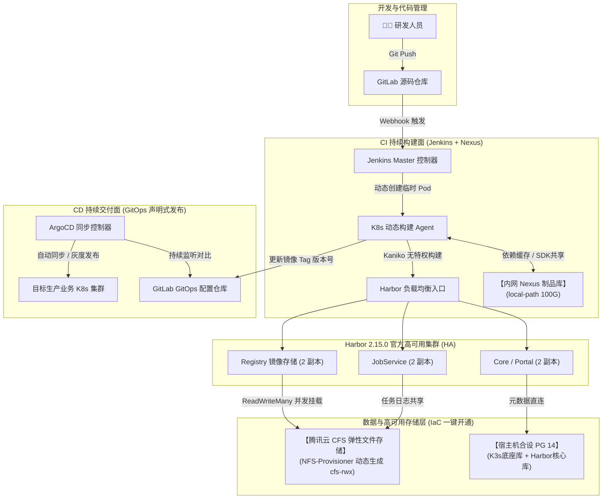

# 企业级生产架构演进指南 (Enterprise Architecture Blueprint)

> 本文档详细阐述本开源项目如何吸纳大型运营商（中国移动“磐舟”平台）与金融级生产环境规范，从原本的个人教学 Demo 级拓扑，演进为兼顾**极低资源成本**与**官方标准高可用**的企业级云原生 DevOps 交付底座。

---

## 一、 为什么要做这次架构演进？（四大现实痛点与解决方案）

| 痛点场景 | 传统轻量级开源 Demo 做法 | 融入“磐舟”规范后的企业生产级解法 |
| :--- | :--- | :--- |
| **痛点 1：公网依赖与内网断供** | 依赖外网拉取 Maven/npm，易遭网络抖动或外网源限流封禁；严苛内网隔离环境下无法运行。 | **引入 Nexus 3 内网制品库与代理**：在集群内网缓存公网依赖，支持内网私有 SDK 托管，实现离线/内网极速构建。 |
| **痛点 2：Harbor 镜像单点与磁盘瓶颈** | 单机单盘 Harbor，高并发构建下出现挂起、磁盘占满或宕机导致全平台瘫痪。 | **升级 Harbor 官方 2.15.0 HA 多副本架构**：严格遵循官方规范，通过腾讯云 CFS 动态提供 `ReadWriteMany (RWX)` 共享存储，无状态组件多副本运行。 |
| **痛点 3：服务器资源浪费** | 为了跑一个简单的数据库容器，多开一台云服务器，增加网络延迟与每月账单。 | **宿主机合设运行 PostgreSQL 14 并持久化**：单台主力 CVM 宿主机预置双库（K3s 底座库 + Harbor 专属库），节省 50% 服务器成本。 |
| **痛点 4：CI/CD 职责混乱** | 在 Jenkins 脚本末端直接敲 `kubectl apply` 发布生产，缺乏版本审计留痕，回滚繁琐。 | **借鉴磐舟“CI 与 CD 严格解耦”**：Jenkins 仅做镜像构建打标与产物归档，部署发布全面交由 **ArgoCD 声明式 GitOps** 闭环。 |

---

## 二、 生产级端到端架构拓扑



---

## 三、 核心基础设施 Terraform 编排细节

### 1. 腾讯云 CFS 与 ReadWriteMany StorageClass (`cfs.tf`)
Harbor 官方 2.15.0 文档明确指出，多副本 Registry 在跨节点伸缩时，镜像分层必须由支持 `ReadWriteMany` 的 StorageClass 提供底层挂载。
通过 Terraform 一键声明腾讯云全托管 NFS 文件系统，并在 K8s 内部署 `nfs-subdir-external-provisioner`，自动生成名为 `cfs-rwx` 的动态存储类：
```hcl
resource "tencentcloud_cfs_file_system" "harbor_cfs" {
  name            = "devops-harbor-cfs"
  zone            = var.availability_zone
  vpc_id          = tencentcloud_vpc.tf_vpc.id
  subnet_id       = tencentcloud_subnet.tf_service_subnet.id
  access_group_id = tencentcloud_cfs_access_group.cfs_ag.id
  protocol        = "NFS"
  storage_type    = "SD"
}
```

### 2. 宿主机合设运行 PostgreSQL 14 并自动预建双库
在单台高性能云主机上运行独立的 PostgreSQL 容器，监听宿主机 5432，并在启动时全自动执行 SQL 脚本：
- 创建 `kubernetes` 数据库与 `k3s` 角色（供给 K3s 集群底座）；
- 创建 `registry` 数据库与 `harbor` 角色（供给 Harbor HA 外部数据源）。

### 3. Nexus 3 制品库 Helm 编排
- 内存分配：预设 `-Xms2g -Xmx2g` 堆内存与 2G DirectMemory，满足高并发依赖请求；
- 持久化：绑定 `local-path` 高速本地盘（100G），确保存储稳定；
- 暴露访问：绑定 `gitlab-nginx` Ingress Controller，开放 `http://nexus.${domain}`。

---

## 四、 快速上手与一键拉起

### 1. 配置云凭证
编辑 `terraform-infra/terraform.tfvars`，填写你的腾讯云 API 密钥与域名：
```hcl
secret_id  = "AKIDxxxxxxxx"
secret_key = "xxxxxxxxxxxx"
domain     = "yourdomain.com"
prefix     = "devops"
region     = "ap-guangzhou"
availability_zone = "ap-guangzhou-3"
```

### 2. 执行一键生成
```bash
cd terraform-infra
terraform init
terraform apply -auto-approve
```

### 3. 查看输出并验证
执行完成后，控制台将输出所有组件的统一访问入口：
- **Nexus 3 制品库**：`http://nexus.devops.yourdomain.com`（默认管理员 `admin`）
- **Harbor HA 镜像库**：`https://harbor.devops.yourdomain.com`（多副本运行，底层连接 CFS `cfs-rwx`）
- **Jenkins 持续集成**：`http://jenkins.devops.yourdomain.com`
- **ArgoCD 持续交付**：`http://argocd.devops.yourdomain.com`
- **GitLab 源码平台**：`https://gitlab.devops.yourdomain.com`
- **SonarQube 代码审计**：`http://sonar.devops.yourdomain.com`
- **Grafana 统一监控**：`http://grafana.devops.yourdomain.com`
